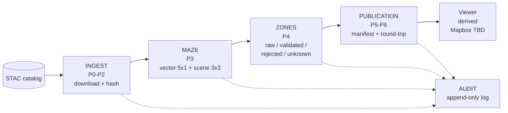
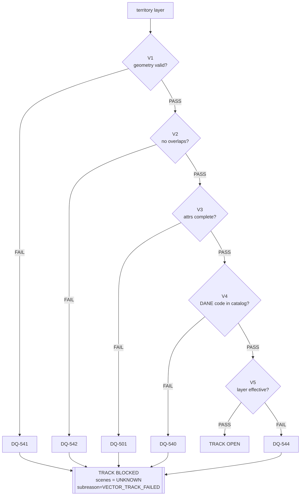
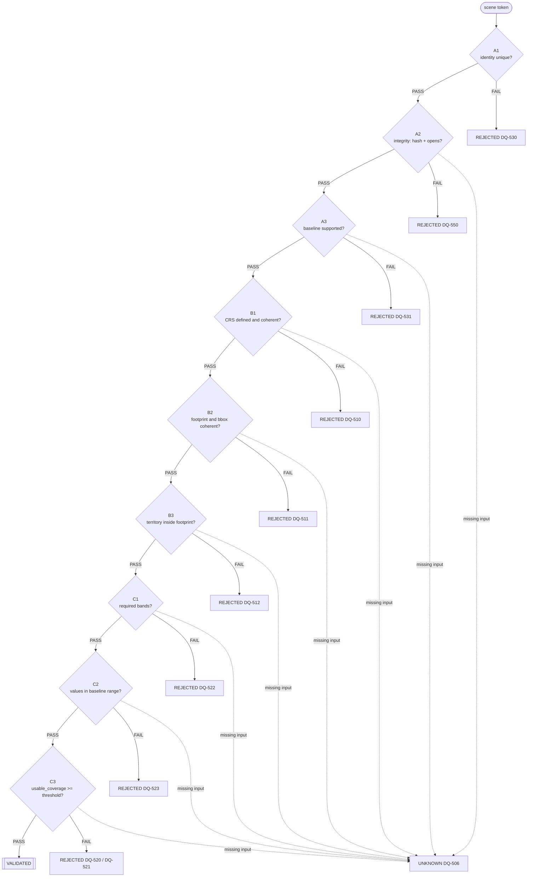
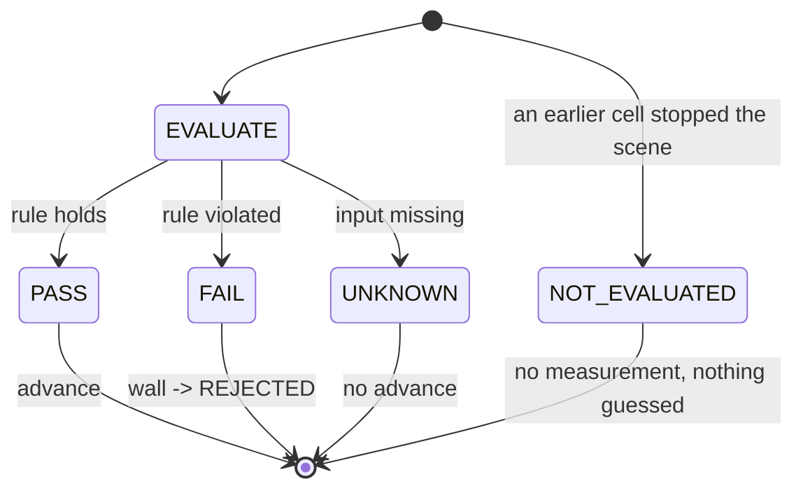
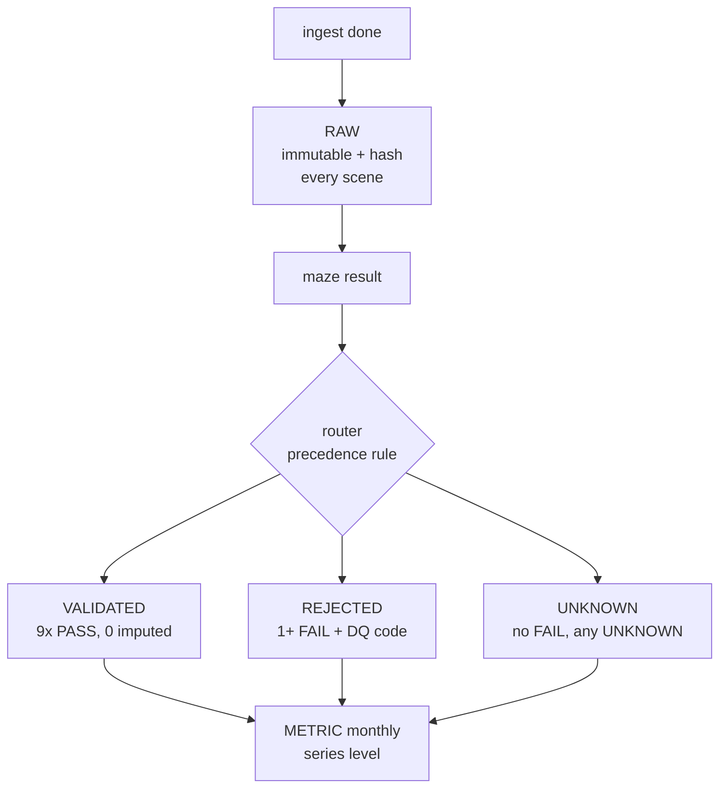
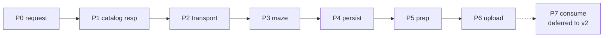
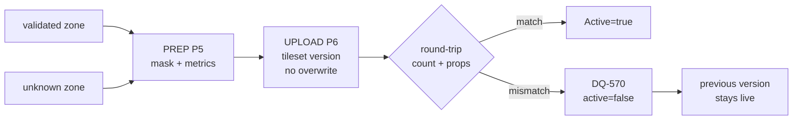
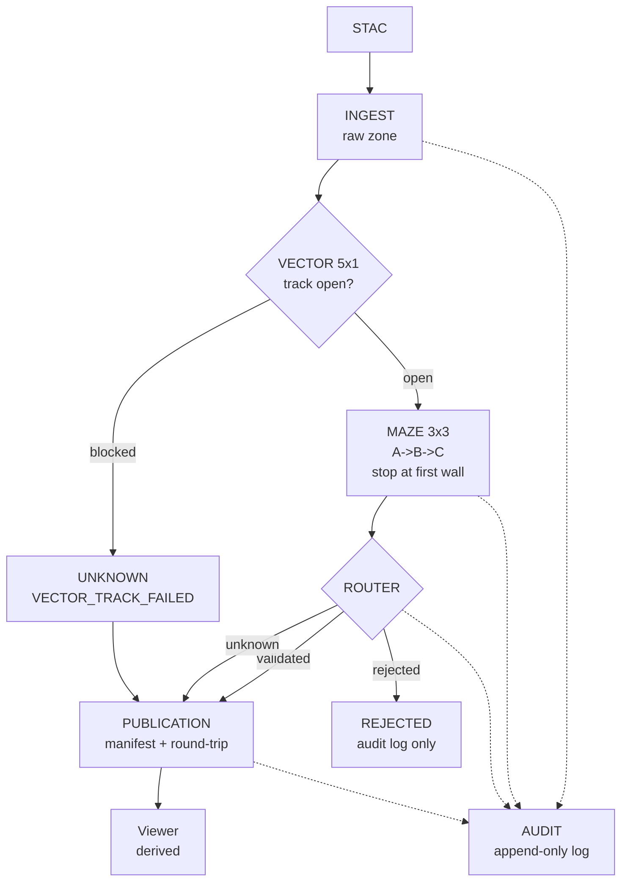

# Maze Flow — End-to-End Visual

> Status: draft v0.2. All project artifacts (code, docs, contract, UI) are in English.

## Glossary (contract ES → code EN)

| Contract (ES) | Code (EN) |
|---|---|
| escena | `scene` |
| casilla | `cell` |
| laberinto | `maze` |
| pista vectorial | `vector_track` |
| territorio | `territory` |
| evaluación | `evaluation` |
| zona | `zone` |
| cruda / validada / rechazada / unknown | `raw` / `validated` / `rejected` / `unknown` |
| umbral | `threshold` |
| regla | `rule` |
| vigente | `effective` |
| submotivo | `subreason` |
| huella | `footprint` |
| cobertura útil | `usable_coverage` |
| píxel observado | `observed_pixel` |
| corrida / ejecución | `run` |
| publicación | `publication` |
| manifiesto | `manifest` |
| evento de auditoría | `audit_event` |

## 1. High-level pipeline

**Rule:** the viewer is *derived*. Truth lives in the `validated` zone + audit chain.

## 2. Vector track (5x1)

## 3. Scene maze (3x3)

Rule shown by the dotted edges: a cell whose input is absent returns `UNKNOWN` with subreason `MISSING_INPUT`. After any non-PASS cell (a wall or a missing input) the remaining cells are `UNKNOWN / NOT_EVALUATED`. Nothing is guessed.

## 4. Gate state machine

## 5. Zones & partitioning

RAW is written at ingestion, before the maze, for every scene. The router only chooses among `validated`, `rejected` and `unknown`. The monthly metric reads all three zones, because "where we know and where we do not" needs the rejected and unknown areas too.

## 6. Audit chain

## 7. Publication & viewer

UNKNOWN areas are published with their own visible style (hatched), never as empty space.

## 8. One-glance summary

## P0 decisions

- [x] Precedence FAIL > UNKNOWN. A scene that stops at a wall has FAIL on that cell and NOT_EVALUATED (UNKNOWN) on the rest, and is routed to `rejected`.
- [x] V5 (layer effective) is the vector track gate: it runs once per layer version and blocks every scene of that territory. It is not a scene-level precondition.
- [x] B3 threshold: strict 100% in v1. Revisit with real tile metadata for Barranquilla.
- [x] C1 (required bands) stays a cell in row C. Revisit after the data access probe (STAC asset list vs opening the file).
- [x] A2 and A3 stay separate. If A3 never fails in 12 months of data, remove it instead of merging.
- [x] P7 is deferred to v2.
- [ ] Publication scope: open until the viewer is chosen (Mapbox or an open alternative).
- [ ] D1: reduce audit points from 8 to 4 (ingestion P0-P2, maze P3, persistence P4, publication P5-P6). Pending approval.
- [ ] D2: hash chain on the audit log. Recommendation: postpone and use git for tamper evidence. Pending approval.
- [ ] D6: vector track in v1 limited to 3 checks (V1 geometry, V3 attributes, V4 + V5 code and version); V2 overlaps returns in v1.5. Pending approval.
